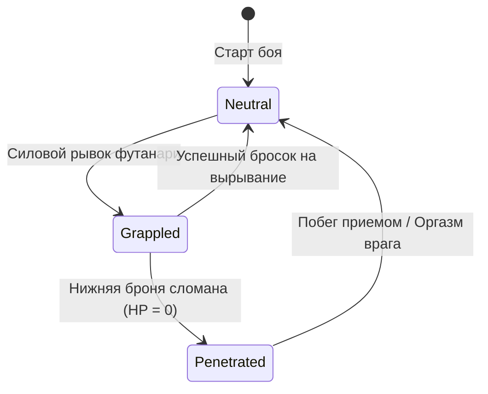
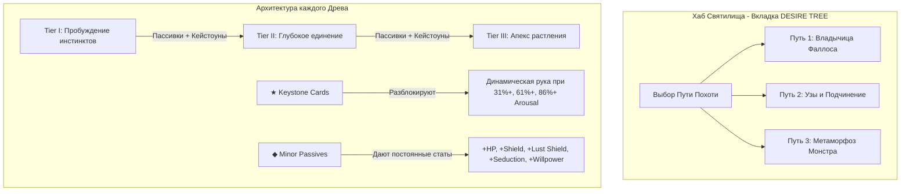

# GAME DESIGN DOCUMENT: UNBRIDLED SANCTUM

> **Версия:** 1.5 (Narrative Reconciliation & Episodic Biome Concept)  

> **Жанр:** Erotic Roguelike Deckbuilder / Dungeon Crawler  

> **Сеттинг:** Dark Fantasy / Monster-girl Domination (70% Futanari, 30% Female, мир без убийств)  

> **Роль игрока:** Парень-студент из нашего мира, чье сознание древним Протоколом вплавлено в искусственный боевой Сосуд (Living Crucible)  

> 💡 **Принцип живого документа (Living Document & Agile Design):**  
> Данный ГДД является стратегическим вектором развития и концептуальным ориентиром проекта, а не застывшим сводом догматических правил, требующим буквального следования точь-в-точь. В процессе прототипирования, тестирования и итераций допустимы разумные отклонения, временные тестовые упрощения и гибкие решения. Идеально спланировать каждую деталь игры с самого начала невозможно без неоправданных затрат времени — геймдизайн дорабатывается и шлифуется органично на основе реального игрового опыта и ощущений от геймплея.

---


## Оглавление

1. [Видение и ключевые столпы (Design Pillars)](#1-видение-и-ключевые-столпы)

2. [Нарративный концепт: Протокол Древних, Семя Монстров и Пробуждение Чувственности](#2-нарративный-концепт-протокол-древних-семя-монстров-и-пробуждение-чувственности)

3. [Честный аудит требований и дизайн-решений](#3-честный-аудит-требований-и-дизайн-решений)

4. [Боевая система и Баланс Действий (AP и Инициатива)](#4-боевая-система-и-баланс-действий-ap-и-инициатива)

5. [Карточная система: Динамика Похоти (0 $\to$ 1 $\to$ 2 $\to$ 3 карты в бою)](#5-карточная-система-динамика-похоти-0--1--2--3-карты-в-бою)

6. [In-Combat NSFW и Позиционная борьба (Struggle Engine)](#6-in-combat-nsfw-и-позиционная-борьба-struggle-engine)

7. [Механика Поглощения Семени (Absorption) и Эстетический Визуал](#7-механика-поглощения-семени-absorption-и-эстетический-визуал)

8. [Мета-Прогрессия в Лобби: Главная Боевая Ветка и Пути Похоти](#8-мета-прогрессия-в-лобби-главная-боевая-ветка-и-пути-похоти)

9. [Изменения тела (Paper Doll, Архив Плоти и Мутации)](#9-изменения-тела-paper-doll-архив-плоти-и-мутации)

10. [Экспедиции, Биомы (3 Тира) и Силовые Ивенты](#10-экспедиции-биомы-3-тира-и-силовые-ивенты)

11. [Roadmap реализации (Эпизодическая модель: 1 локация = 1 обновление)](#11-roadmap-реализации-эпизодическая-модель-1-локация--1-обновление)


---


## 1. Видение и ключевые столпы


```

                 ┌────────────────────────────────────────────────────────┐

                 │                  UNBRIDLED SANCTUM                     │

                 │      (Разум Человека vs Био-Память и Инстинкты Сосуда) │

                 └────────────────────────────────────────────────────────┘

                                      │

         ┌────────────────────────────┼───────────────────────────┐

         ▼                            ▼                           ▼

 ┌───────────────┐           ┌─────────────────┐         ┌─────────────────┐

 │ DUALITY DECK  │           │ STRUGGLE COMBAT │         │ LOBBY META HUB  │

 │ Разум Студента│           │ Непрерывный бой │         │ Терминал Камня +│

 │ против Тела   │           │ без убийств     │         │ Адаптация Плоти │

 └───────────────┘           └─────────────────┘         └─────────────────┘

```


1. **Конфликт «Мужской Разум Студента vs Физиология и Чувственность Сосуда»:** Сознание обычного парня-студента оказывается заперто в чужом для него женском теле искусственного Сосуда. Главный конфликт — не героический пафос воина, а глубокий психологический и телесный слом: парень вынужден осваивать женскую пластику, привыкать к своей новой анатомии и переживать чувственный шок, когда женское тело начинает искренне откликаться на ласки и подавляющую силу монстро-девочек, доставляя ему всё большее удовольствие.

2. **Секс как продолжение противостояния (Мир без убийств):** Силовой захват, проникновение и оральный контакт — активные тактические состояния. Оружие и щиты служат лишь для сбивания темпа и истощения выносливости противниц, а победа над владычицами достигается выдержкой в партере, перехватом инициативы и доведением их до оргазма (*Overstimulation Victory*).

3. **Эстетика и Поглощение Семени (Absorption) вместо Вздутия:** Никакого уродливого шарообразного живота или беременности. Тело сохраняет изящную, аппетитную женственную фигуру. Изливаемое монстрами семя (**Cum**) — концентрированная биологическая эссенция, которую Сосуд усваивает напрямую тканями, питая защитные барьеры *Lust Shield*, конвертируя излишки в *Lustid* и зажигая эротические руны *Womb Tattoo*.

4. **Великая Гармонизация вместо Стерилизации мира:** Конечная цель сюжета — не «очистить мир от скверны» (уничтожив футанари), а замкнуть энергетический контур Святилища, подчинить Матриархов биомов и стать признанной Верховной Владычицей (*Apex Matriarch*), объединившей дикие земли.

5. **Эпизодическая модель обновлений (1 локация = 1 глава = 1 Матриарх):** Контент вводится модульно. Каждый биом обладает 3 уровнями глубины (Тирами сложности), уникальным фетишем угроз и законченной аркой подчинения Матриарха.


---


## 2. Нарративный концепт: Протокол Древних, Семя Монстров и Пробуждение Чувственности


### 2.1. Тайное Убежище (Sanctuary Hub)

* **Мирный грот в глуши:** Пещера Святилища — не подземелье и не тюрьма. Это скрытый командный узел Древних, укрытый в диких пустошах. 

* Здесь **нет врагов, ловушек и опасности**. Это безопасный дом героини (Sanctuary Hub / Лобби), где она отдыхает, кастомизирует формы тела, общается с укрощенными Матриархами и обращается к Терминалу.


### 2.2. Первородный Камень (The Primordial Terminal)

* В центре грота возвышается древний монолит — аппаратный терминал био-магической системы создателей.

* **Автономный протокол решения кризиса:** Камень — не капризный бог и не вымогатель. Это автоматическая система, зафиксировавшая переизбыток неуправляемой энергии плодородия и семени в мире. Протокол активировался, вырастил совершенный женский Сосуд (Living Crucible) и призвал стабильное внешнее сознание (душу обычного парня-студента).

* **Функции Камня в геймплее:**

  * **Точка ментального бэкапа:** При падении в бою (истощение HP или Willpower) душа героини переносится обратно в терминал, восстанавливая Сосуд.

  * **Консоль адаптации:** Переводит накопленный опыт взаимодействия с семенем монстров (*Lustid*) в разблокировку талантов, стабилизацию мутаций и расширение возможностей тела.


### 2.3. Природа мира: Семя Монстров и Единственный Сосуд

* **Экосистема мира (70% футанари, 30% женщин):** В мире нет обычных самцов. Размножение и эволюция видов веками происходили через перенос мощного семени доминантных футанари.

* **Почему мир сфокусирован на героине:**

  * Обычные женщины этого мира хрупки: они физически не способны выдержать колоссальный напор семени и безудержную похоть могучих существ.

  * Героиня — **единственный в мире искусственный «Сосуд» (Living Crucible)**, чья матка и Womb Tattoo спроектированы для безопасного поглощения, фильтрации и усвоения литров семени (**Cum**). Для футанари она — высшая святыня, идеальный партнер и непреодолимый магнит.


### 2.4. Матриархи Биомов (Вместо банального «спермотоксикоза»)

* **Природа Владычиц:** Хранительницы биомов (**Матриархи / Apex Matriarchs**) — не безумные маньячки. Они — территориальные полубожественные правительницы дикой природы, живущие по древнему праву силы и доминирования.

* **Суть схватки (Поединок Иерархии):**

  * Матриарх нападает, стремясь подчинить Сосуд своей воле и излить в него свою накопленную первобытную мощь.

  * Героиня побеждает не убийством, а **тактической стойкостью**: изнуряет Матриарха парированиями, переживает захваты, берет инициативу в свои руки и доводит владычицу до сокрушительного оргазма (*Overstimulation Victory*).

* **Статус после победы:**  

  * Поверженная Матриарх признает силу и божественный авторитет Сосуда. Она заключает союз, передает свое Первородное Ядро и становится нейтральным персонажем (появляется в Хабе для диалогов или открывает проход дальше).

  * **Дикая фауна остается враждебной:** Рядовые монстры биома продолжают охотиться инстинктивно, сохраняя боевой геймплей рогалика в зачищенных локациях.


### 2.5. Концепция боя мечом в мире без убийств

* Меч и щит — это не оружие смертоубийства, а **инструмент дистанционного контроля и истощения (Stamina / Posture Damage)**:

  * Удары клинком сбивают броню монстров и истощают их шкалу выносливости.

  * Чем сильнее измотана футанари на дистанции, тем легче героине перехватить контроль и провести фатальные приемы ублажения, когда дистанция сомнется в партер.


### 2.6. Четыре стадии эволюции Сосуда (Синхронизация сюжета и механик)

В отличие от ранней версии, доступ к эротическим выборам жестко привязан к нарративному взрослению персонажа:


```

[ 1. ОТРИЦАНИЕ И ШОК ] ───► [ 2. ТАКТИЧЕСКИЙ РАСЧЕТ ] ───► [ 3. ЧУВСТВЕННЫЙ НАДЛОМ ] ───► [ 4. ВЕРХОВНАЯ ВЛАДЫЧИЦА ]

  "Я парень, выпустите меня!   "Силой их не взять. Буду      "Боги... тело плавится от     "Я — Сосуд этого мира. Мой

   Меч — всё, что мне нужно."   использовать их же похоть."   экстаза. Я жажду больше..."   разум правит их страстью."

```


1. **Стадия I: «Отрицание и шок» (Ран 1–2):**

   * Сознание студента бунтует. В лобби **заблокированы Пути Похоти** — доступны только базовые боевые карты стража.

   * В ивентах кнопка *«[Откупиться телом]»* недоступна (мысль: *«Ни за что! Лучше сдохнуть в бою!»*).

2. **Стадия II: «Тактический расчет» (Вынужденный компромисс):**

   * Открывается после первого поражения в захвате. Разум признает превосходство массы врагов.

   * Разблокируется выбор первого **Пути Похоти** и холодный расчет в ивентах (*«Я отдаюсь лидеру не ради похоти, а чтобы сберечь броню и изучить их повадки»*).

3. **Стадия III: «Чувственный надлом» (Гормональная перестройка):**

   * Эссенция семени в Womb Tattoo перестраивает нейронные связи. Женская чувственность берет верх над мужской памятью: соитие дарит взрывное наслаждение.

   * Открываются продвинутые фетиш-карты высшего тира.

4. **Стадия IV: «Верховная Владычица» (Абсолютный Симбиоз и Триумф):**
   * Тотальная гармония мужского тактического интеллекта и непревзойденной чувственности Сосуда.
   * Героиня выходит в биомы с грацией императрицы: она больше не жертва, а повелительница страсти, подчиняющая Матриархов щелчком пальцев.

### 2.7. Финальная цель: Великая Гармонизация (The Great Conjunction)
* **Основная сюжетная кампания:** Пройти все доступные биомы, укротить всех 4 Матриархов, активировать пограничные обелиски и замкнуть избыточный поток семени и плодородия на Святилище.

* **Кульминация:** Героиня коронуется как Верховная Владычица мира. Буря магии укрощена, мир спасен от саморазрушения.

* **Бесконечный Эндгейм:** Открытие режима «Искаженные Биомы» (мутаторы сложности, испытания чистой похоти, охота за редкими семенными мутациями и глубокая кастомизация).


---


## 3. Честный аудит требований и дизайн-решений


| Параметр | Итоговое решение | Обоснование / Ограничение |

|---|---|---|

| **Протагонист** | **Студент в Сосуде Древних** | Разум парня в женском теле, постепенно открывающий для себя удовольствие подчинения. |

| **Природа врагов** | **Матриархи (Мир без убийств)** | Вместо «спермотоксикоза»: ритуальные поединки иерархии, доминирования и страсти. |

| **Размеры футанари** | **Внушительные (20–35 см)** | Отказ от гипер-размеров. Фетиш назван *«Любительница членов» (Phallus Admirer)*. |

| **Оральные приемы** | **Без укусов и боли** | Заменено на приемы контроля: *«Горловой замок» (Throat Lock)*, глубокую стимуляцию и перехват инициативы. |

| **Визуал живота** | **ОТКАЗ от Belly Inflation** | Никакого раздутого живота. Стройное тело + *Womb Tattoo (светящаяся печать матки)* + подтеки семени на бедрах. |

| **Поглощение семени** | **Триада: Cum / Lust Shield / Creampie** | Семя (**Cum**, мл) в отверстиях дает: барьер **Lust Shield**, статус наполнения **Creampie**, регенерацию HP и валюту *Lustid*. |

| **Карты похоти в руке** | **Вариант А: 0 $\to$ 1 $\to$ 2 $\to$ 3 в бою** | Число карт фетиша в руке растет строго от текущего уровня возбуждения (*Arousal*) во время схватки. |

| **Пул карт фетишей** | **Система Главных Путей (9 карт на путь)** | Игрок выбирает 1 Путь в лобби. Карты в бою берутся строго из выбранного пути, без размытия пула на 40 карт. |

| **Прокачка в Лобби** | **Боевая Ветка + Древо Путей за Lustid** | 1 постоянная Боевая ветка (HP, броня, атака) + переключаемые Пути Похоти (привязаны к 4 Стадиям). |

| **Базы груди** | **4 Базы (Small, Medium, Large, XLarge)** | Рост на экранах перехода между клетками; Архив Плоти (`???` $\to$ раскрытие статов); кастомизация/сброс в хабе. |

| **Структура релизов** | **1 локация = 1 обновление (3 Тира)** | Эпизодическая модель: 3 Тира глубины на биом, 1 Матриарх на главу. Защита от перегрузки продакшена. |

| **Боевые ресурсы** | **Базовые 3 AP (Без кубика)** | Стабильный расчет действий без лишнего раздражающего рандома. |


---


## 4. Боевая система и Баланс Действий (AP и Инициатива)


* **Фиксированные 3 AP (Action Points):** Стабильный пул очков действий в начале каждого хода игрока.

* **Шкала Инициативы (Turn Order):** Определяет очередность ходов персонажей.

* **Влияние Похоти на AP:**

  * До 60% Arousal: полноценные 3 AP на любые действия.

  * Выше 85% Arousal: тело слабеет от истомы (минус 1 AP на атаки оружием, но фетиш-карты в этот ход стоят 0 AP).


---


## 5. Карточная система: Динамика Похоти (0 $\to$ 1 $\to$ 2 $\to$ 3 карты в бою)


Рука игрока формируется из **базовых карт тактики воина** и **динамических слотов инстинктов выбранного Пути Похоти**:


```

                       ДИНАМИКА ПРИХОДА КАРТ В БОЮ:

┌──────────────────────────┬────────────────────────────────────────────────────────┐

│ Уровень Arousal (Похоть) │ Состав руки игрока (из Пула выбранного Пути)           │

├──────────────────────────┼────────────────────────────────────────────────────────┤

│ 0% – 30% (Холодный ум)   │ 4 карты тактики воина + 0 карт похоти                  │

│ 31% – 60% (Возбуждение)  │ 4 карты тактики воина + 1 карта похоти (розовый слот)  │

│ 61% – 85% (Сладострастие)│ 3 карты тактики воина + 2 карты похоти                 │

│ 86% – 100% (Грань оргазма)│ 2 карты тактики воина + 3 карты похоти                 │

└──────────────────────────┴────────────────────────────────────────────────────────┘

```


### Защита от засорения колоды (Anti-Bloat Rules):

1. **Карты инстинктов временные (Ephemeral):** Они не замешиваются в колоду намертво. Если карта не сыграна за ход — она сгорает в конце хода.

2. **Смена стоек в захвате (Stance Swap):** При переходе в силовой захват (*Grappled*) рука оружия временно блокируется и заменяется 4 базовыми картами борьбы (*«Вырваться» / Break Free, «Чувственная ласка» / Sensual Caress, «Смена опоры» / Shift Leverage, «Клинч» / Clinch & Hold* или *«Контр-сжатие» / Counter Clench* в партере).

3. **Умная контекстная раздача карт похоти (Context-Aware Smart Draw):**
   * **Проблема «Мёртвой руки» исключена на корню:** Игрок физически не может получить карту орального секса, если его рот свободен, или карту борьбы в партере, если он стоит в нейтральной стойке на дистанции.
   * **Двухуровневая структура пула карт каждого Пути:**
     * **Позиционные карты (Position-Locked):** Узкоспециализированные мощные приемы под конкретные отверстия и состояния тела (*«Горловой замок»* и *«Глубокое заглатывание»* для рта, *«Вагинальный спазм»* и *«Втягивание лоном»* для вагины, *«Удар связанными ногами»* и *«Реверс запястья»* для борьбы). При соблюдении условий получают наивысший приоритет выборки (Priority 200).
     * **Универсальные карты (Any-Stance / Vocal & Mental):** Рефлексы и проявления чувственности Сосуда, доступные **всегда** (*«Томный стон / Whimper»*, *«Покорная мольба / Plead»*, *«Барьер похоти / Lust Barrier»*, *«Дыхание истомы / Breath of Ecstasy»*, *«Феромоны / Pheromones»*, *«Смягчающий бюст / Bust Cushion»*).
   * **Приоритет выборки (Ranking & Weighting):**
     * *Приоритет 1 (Max, 200):* Позиционные приемы для активных занятых отверстий врагами прямо сейчас.
     * *Приоритет 2 (High, 150):* Приемы борьбы при захвате/связывании.
     * *Приоритет 3 (Distance, 140):* Дистанционные приемы в нейтральной стойке.
     * *Приоритет 4 (Universal, 100):* Универсальные карты стонов, щитов, ментального охлаждения и ласк.
   * **Гарантированная подстраховка (Universal Fallback Safety Net):**
     * Если у игрока в Древе открыто мало карт или все открытые карты не подходят под текущую позу, рука добирается из универсальных карт активного Пути. Количество карт похоти ВСЕГДА строго соответствует уровню Arousal (1 при $\ge 31\%$, 2 при $\ge 61\%$, 3 при $\ge 86\%$), и каждая карта в руке гарантированно играбельна!
   * **Физические ограничения органов:** При оральном проникновении (*Throat Lock*) вербальный шепот физически невозможен и заменяется горловыми приемами и стонами.

---


## 6. In-Combat NSFW и Позиционная борьба (Struggle Engine)





1. **Neutral (Дистанция):** Обычный бой оружием, магией и щитами. Оружие истощает броню и выносливость (Stamina).

2. **Grappled (Силовой захват):**

   * Враг прижимает ГГ к полу/стене, держит за запястья или шею.

   * Карты оружия заблокированы; разыгрываются карты ближней борьбы и ласк.

3. **Penetrated / Throat Lock (Секс в бою):**

   * Активно только при разрушенной одежде.

   * Каждый ход футанари совершает фрикции, нанося урон концентрации и вливая семя (**Cum**).

   * **Условие победы внутри акта:** Перегрузить футанари ласками до оргазма (*Overstimulation Victory*) быстрее, чем ГГ потеряет сознание от изнеможения.


---


## 7. Механика Поглощения Семени (Absorption) и Эстетический Визуал


### Полный отказ от раздутого живота:

* Живот героини остается **плоским, спортивным и привлекательным**.

* Никаких гротескных деформаций, ломающих сексуальность персонажа.


```

        ┌────────────────────────────────────────────────────────┐

        │             КРУГОВОРОТ СЕМЕНИ (SEMEN DIGESTION)        │

        └────────────────────────────────────────────────────────┘

                                    │

                                    ▼

                     [ Осеменение в бою / ивенте ]

                       (Влагалище, Анал, Желудок)

                                    │

                                    ▼

                     [ Накопление объема (мл) ]

              (Womb Tattoo разгорается + подтеки на бедрах)

                                    │

                                    ▼

                     [ Усвоение тканями (Absorption) ]

                                    │

         ┌──────────────────────────┼──────────────────────────┐

         ▼                          ▼                          ▼

  [ Регенерация HP ]       [ Барьер Lust Shield ]     [ Валюта Lustid ]

```


### Визуализация наполнения на Paper Doll:

1. **Womb Tattoo (Печать матки):** Магическая татуировка суккуба внизу живота. Имеет 3 стадии свечения (тусклое $\to$ мерцающее $\to$ пылающее розовым неоном по мере усвоения семени).

2. **Creampie Overflow (Оверлей жидкостей):** Семя стекает по внутренней стороне бедер героини.

3. **Румянец и испарина:** Лицо выражает томность и жар от внутренней энергии.


---


## 8. Мета-Прогрессия в Лобби: Главная Боевая Ветка и Пути Похоти


В Лобби (**Sanctuary Hub**) игрок инвестирует заработанный в забегах *Lustid* и *Lumieres* в две независимые системы:


```

┌────────────────────────────────────────────────────────────────────────────┐

│                    ХАБ / СВЯТИЛИЩЕ (SANCTUARY HUB)                        │

├─────────────────────────────────────┬──────────────────────────────────────┤

│ 1. ГЛАВНАЯ БОЕВАЯ ВЕТКА ВОИНА       │ 2. ВЫБОР ПУТИ ПОХОТИ                 │

│    (Работает ВСЕГДА во всех забегах)│    (Свободное переключение между     │

│    • Макс. HP и Защита Одежды       │    забегами: формирует пул 9 карт    │

│    • Урон оружия и Щиты             │    похоти и уникальные таланты)      │

│    • Воля / Сопротивление похоти    │    • Путь А: Владычица Фаллоса       │

│    • Скорость и Очередь ходов       │    • Путь Б: Узы и Подчинение        │

│                                     │    • Путь В: Мутация и Плодородие    │

└─────────────────────────────────────┴──────────────────────────────────────┘

```


---


### РАЗДЕЛ I: ГЛАВНАЯ БОЕВАЯ ВЕТКА (CORE COMBAT TREE)

*Постоянные фундаментальные характеристики выживания Сосуда. Активны в 100% забегов:*


1. **Закалка Тела (Max HP):**

   * Ур. 1–5: Увеличение базового здоровья (+5 HP за уровень, до +25 HP).

2. **Армированная Ткань (Clothes Durability):**

   * Ур. 1–5: Повышение прочности верхней и нижней одежды (+10 Clothes HP за уровень). Одежду труднее порвать.

3. **Стойкость Разума (Willpower / Sanity):**

   * Снижает скорость накопления возбуждения (*Arousal*) от обычных вражеских атак на 10% / 20% / 30%. Дольше держит ГГ в состоянии хладнокровия.

4. **Боевая Инициатива (Speed & Turn Order):**

   * Дает гарантированное право первого хода в комнатах засад.

5. **Мастерство Оружия (Blade & Shield):**

   * Базовые карты *Strike* наносят +2 урона выносливости/броне, а базовый *Block* дает +2 к показателю щита.


---


### РАЗДЕЛ II: СИСТЕМА ДРЕВА ЖЕЛАНИЙ (DESIRE TREE / PATHS OF DESIRE)

*Реализована в отдельной 4-й вкладке Лобби («DESIRE TREE»). Решает проблему захламления руки фетиш-картами со старта и дает игроку четкую вертикальную прокачку за Lustid:*



#### Архитектура узлов Древа Прокачки:
1. **Малые узлы (Minor Passives):** Доступны за Lustid в дереве прогрессии. Дают постоянные прибавки к выживаемости и эротической силе:
   * **+ Max HP:** Увеличение живучести Сосуда.
   * **+ Shield / + Lust Shield:** Стартовая броня и емкость барьера семени.
   * **+ Seduction Power (%):** Ускоренное введение врагов в возбуждение.
   * **+ Willpower:** Замедление потери самоконтроля при атаках.
2. **Ключевые узлы (Keystones):** Кульминационные узлы каждого Тира. Именно они перманентно открывают соответствующие эротические карты фетиша в боевую колоду похоти (в боевой пул активного пути). Без их прокачки карты не выпадают в бою, сохраняя чистоту и фокус стратегии.

#### ПУТЬ 1: «Владычица Фаллоса» (Phallus Devotee)
*Фокус на оральном мастерстве, глубоком вагинальном сжатии и конверсии принятого семени (Cum).*
* **Под-ветка А: Оральное мастерство (3 карты):**
  * `breath_of_ecstasy` (*«Дыхание истомы»*, 0 AP, CD 1, Any) — **[Универсальная: Mental/Breath]** Выдох охлаждает горящую кровь: -15% Arousal героини.
  * `throat_lock` (*«Горловой замок»*, 1 AP, CD 1, PenetratedOnly / Mouth) — **[Позиционная: Mouth]** Плотный обхват горлом: 10 Stamina dmg, +25% Arousal врага.
  * `deep_swallow` (*«Глубокое заглатывание»*, 2 AP, CD 2, PenetratedOnly / Mouth) — **[Позиционная: Mouth]** Полное принятие в горло: +40% Arousal врага, впитывает 50ml Cum, исцеляет 8 HP.
* **Под-ветка Б: Вагинальное соитие (3 карты):**
  * `enticing_glance` (*«Соблазняющий взгляд»*, 1 AP, CD 1, NeutralOnly) — **[Позиционная: Neutral/Distance]** +20% Arousal врага с дистанции.
  * `vaginal_clench` (*«Вагинальный спазм»*, 1 AP, CD 1, PenetratedOnly / Vagina) — **[Позиционная: Vagina]** Ритмичное сжатие: 12 Stamina dmg, +30% Arousal врага, впитывает 30ml Cum.
  * `womb_suction` (*«Втягивание лоном»*, 2 AP, CD 2, PenetratedOnly / Vagina) — **[Позиционная: Vagina]** Глубокая перистальтика: 20 Stamina dmg, +45% Arousal врага, извлекает 60ml Cum.
* **Под-ветка В: Трансмутация семени (3 карты):**
  * `lust_barrier` (*«Барьер похоти»*, 1 AP, CD 1, Any) — **[Универсальная: Shield]** Канализирует семя через печать матки: конвертирует принятый Cum в Lust Shield, +15% Arousal врага.
  * `cum_surge` (*«Всплеск семени»*, 1 AP, CD 2, Any) — **[Универсальная: Shield Burst]** Кристаллизует до 40ml принятого Cum в защитный био-кокон (+25 Lust Shield при наличии Cum, +10 Shield).
  * `overwhelming_surrender` (*«Полное подчинение»*, 2 AP, CD 3, Any) — **[Универсальная: Apex Ecstasy]** Тотальное наслаждение: +50% Arousal врага; при наличии $\ge$ 80ml Cum исцеляет 15 HP.
* **Пассивный бонус пути:** При переработке семени в Lust Shield создается дополнительный барьер; оральные и вагинальные приемы наносят повышенный урон выносливости.

---

#### ПУТЬ 2: «Узы и Подчинение» (Bound & Submissive)
*Фокус на силовом контроле, связывании, шлепках, мазохизме и перехвате инициативы из захвата.*
* **Под-ветка А: Веревки и Бондаж (3 карты):**
  * `yielding_curve` (*«Податливый изгиб»*, 0 AP, CD 1, Any) — **[Универсальная: Body Yield]** Прогиб спины в уступчивую позу: +10 Shield, +10% Arousal героини.
  * `bound_kick` (*«Удар связанными ногами»*, 1 AP, CD 1, StruggleOnly) — **[Позиционная: Struggle]** Рывок из пут: 6 HP dmg, 16 Stamina posture damage.
  * `sweet_captivity` (*«Сладостный плен»*, 1 AP, CD 2, StruggleOnly) — **[Позиционная: Struggle/Bound]** Принятие давления пут: +12 Lust Shield, +1 AP на следующий ход.
* **Под-ветка Б: Мазохизм и Шлепки (3 карты):**
  * `spank_reception` (*«Принятие удара»*, 1 AP, CD 1, Any) — **[Универсальная: Masochism]** Боль в жар: +12 Shield, +25% Arousal врага, +10% Arousal героини.
  * `flushed_whimper` (*«Румяный стон»*, 1 AP, CD 2, Any) — **[Универсальная: Vocal Moan]** Беспомощный всхлип: +25% Arousal врага, ослабляет следующую атаку противника.
  * `masochistic_ecstasy` (*«Мазохистский экстаз»*, 2 AP, CD 2, StruggleOnly) — **[Позиционная: Struggle]** Отрезвление от боли: +25 Lust Shield, исцеляет 10 HP, -20% Arousal героини.
* **Под-ветка В: Контроль и Реверс (3 карты):**
  * `submissive_murmur` (*«Покорный шепот»*, 0 AP, CD 1, Any) — **[Универсальная: Vocal Plead]** Шепот похвалы на ухо: отнимает 10 Stamina, +20% Arousal врага. *(Блокируется при Throat Lock).*
  * `wrist_lock_reverse` (*«Реверс захвата запястья»*, 1 AP, CD 2, StruggleOnly) — **[Позиционная: Struggle Reversal]** Выворот руки врага: 8 HP dmg, 18 Stamina dmg, освобождение из захвата.
  * `unbreakable_leash` (*«Неразрывный поводок»*, 2 AP, CD 3, StruggleOnly) — **[Позиционная: Struggle Lock]** Оплетение врага собственными узами: 15 Stamina dmg, +45% Arousal врага.
* **Пассивный бонус пути:** Находясь в захвате (Grappled/Penetrated), героиня получает повышенную броню, а приемы борьбы наносят критический эротический урон.

---

#### ПУТЬ 3: «Мутация и Плодородие» (Monster Transformation)
*Фокус на телесной трансформации, груди, лактации, пробуждении печати суккуба и поглощении сущности монстров.*
* **Под-ветка А: Грудь и Феромоны (3 карты):**
  * `pheromone_spray` (*«Брызги феромонов»*, 1 AP, CD 1, Any) — **[Универсальная: Scent]** Сладкие феромоны из пор кожи: 8 Stamina dmg, +20% Arousal врага.
  * `cushioning_bust` (*«Смягчающий бюст»*, 1 AP, CD 1, Any) — **[Универсальная: Body Bust]** Амортизация чувствительной пышной грудью: +12 Shield, +25% Arousal врага.
  * `milky_relief` (*«Молочный прилив»*, 2 AP, CD 2, Any) — **[Универсальная: Secretion Heal]** Материнское облегчение: исцеляет 12 HP, восстанавливает 15 Stamina, снижает собственный Arousal на 25%.
* **Под-ветка Б: Печать Матки (3 карты):**
  * `womb_pulse` (*«Пульсация лона»*, 1 AP, CD 1, Any) — **[Универсальная: Sigil Wave]** Вспышка татуировки суккуба: +30% Arousal врага, +12 Lust Shield.
  * `succubus_siphon` (*«Сифон суккуба»*, 1 AP, CD 2, Any) — **[Универсальная: Touch Drain]** Вытягивание жизненного жара через кожу: 15 Stamina dmg, +35% Arousal врага, исцеляет 8 HP.
  * `womb_overdrive` (*«Овердрайв тигля»*, 2 AP, CD 3, PenetratedOnly / Vagina) — **[Позиционная: Vagina]** Демонические сокращения: 20 Stamina dmg, +40% Arousal, впитывает 50ml Cum, +20 Lust Shield.
* **Под-ветка В: Демоническая Ассимиляция (3 карты):**
  * `tail_caress` (*«Ласка хвостом»*, 1 AP, CD 1, Any) — **[Универсальная: Appendage]** Демонический хвост обвивает пах врага: 12 Stamina dmg, +25% Arousal.
  * `slime_skin_coating` (*«Слизевое покрытие»*, 1 AP, CD 2, Any) — **[Универсальная: Slime Defense]** Скользкая защитная пленка: +15 Shield, +10 Lust Shield, автоматическое выскальзывание из захвата.
  * `primal_metamorphosis` (*«Первородный метаморфоз»*, 2 AP, CD 3, Any) — **[Универсальная: Apex Form]** Пробуждение природы суккуба: +25 Lust Shield, +2 AP, исцеляет 12 HP, вводит всех врагов в экстаз (+35% Arousal).
* **Пассивный бонус пути:** Повышенная стойкость к эротическому ошеломлению; оргазм врага регенерирует здоровье героини.


---


## 9. Изменения тела (Paper Doll, Архив Плоти и Мутации)


```

┌─────────────────────────────────────────────────────────────┐

│            PAPER DOLL СЛОИ (СНИЗУ ВВЕРХ, 1024×1536)         │

├─────────────────────────────────────────────────────────────┤

│ 1. Каноничный Сосуд (hero_small.png — тело, волосы, лицо)   │

│ 2. Модульная грудь (Breast Medium / Large / XLarge)         │

│ 3. Нижнее белье / одежда (Нижний слой брони)                │

│ 4. Верхняя одежда / корсет (Верхний слой брони)             │

│ 5. Эмоции и Румянец (Оверлей лица: глаза + рот + румянец)   │

│ 6. Womb Tattoo (Светящаяся печать матки - 3 стадии)         │

│ 7. Оверлей жидкостей (Брызги Cum, потеки Creampie)          │

│ 8. Монстро-части / Аксессуары (Рожки, чокер, хвост)         │

└─────────────────────────────────────────────────────────────┘

```

> 💡 **Каноничный образ и стандарт арта:**  
> Героиня обладает единым каноничным обликом боевого Сосуда (*Living Crucible*). Косметический редактор причесок и палитры исключен для обеспечения 100% совпадения образа на кукле, в диалогах и в будущих анимированных H-сценах. Все слои Paper Doll экспортируются на едином бесшовном холсте **`1024 × 1536` px (RGBA32, Zero-Offset)**.


### 9.1. Правила трансформации груди (Small $\\to$ Medium $\\to$ Large $\\to$ XLarge)

* **Стабильный рендеринг без багов в бою:**  
  * Во время карточной фазы боя базовая анатомия костей **не переключается на лету**, чтобы исключить глитчи и конфликты покадровых спрайтов. В бою отображается лишь статус *«Жар / Набухание»* (оверлей румянца, испарины и блеска).
  * **Где происходит физическая смена размера:** Строго на **экранах перехода между узлами карты (Post-Combat Transition / Event Summary)**. После завершения боя при накоплении критического объема Семени срабатывает эротическая интерлюдия: *«Семенной ток перестраивает плоть! Грудь наливается жаром (+1 размер)»*, после чего префаб Paper Doll безопасно подменяет базу тела и одежду.

* **Канонические ограничения (ЗАФИКСИРОВАНО НА БУДУЩЕЕ):**
  * **Только особые виды фута:** Размер груди героини увеличивается от получения семени **строго определенных видов футанари** (Futanari Alpha / высшие демонессы-фута), а не от базовых монстров вроде слаймов или мелких тварей.
  * **Сюжетная блокировка этапом:** Механика изменения размера груди станет доступна игроку только **после определенного этапа/главы в игре** (прохождение Главы 1 / пробуждение Тигля Святилища). До этого порог семени накапливается в Lust Shield без мутации костей.

* **Кастомизация и Сброс в Хабе (Защита от штрафа за фетиш):**  
  * Игрок не должен чувствовать себя наказанным нежелательной деформацией. В Святилище через терминал Камня доступна функция **«Стабилизация тканей»** — свободная фиксация любого из ранее открытых размеров груди (от атлетичного Small до XLarge) без штрафов.

### 9.2. Механика «Архив Плоти» (Progressive Discovery)

* **Условие начисления очков исследования:**  
  Очки изучения бестиария начисляются **ИСКЛЮЧИТЕЛЬНО за получение семени ВНУТРЬ (Internal Cum Intake)**:
  * Оральное проглатывание (Throat Influx & Swallow)
  * Вагинальный кримпэй (Vaginal Creampie)
  * Анальный кримпэй (Anal Creampie)  
  *Попадание семени на кожу снаружи дает защитный барьер Lust Shield, но не дает глубокого анализа внутренней мутации.*

* **Награды игроку за открытие уровней Архива (3 Тира):**
  1. **Tier 1 (Первичное семя внутрь — 75 мл): [Тактическое предвидение / Sensory Insight]**  
     * В бою открывается точное превью намерений монстра этого вида (виден точный урон по одежде/возбуждению вместо скрытого диапазона).  
     * Всплывающий нарративный статус: [ ??? ] — Внизу живота разливается странный зуд...
  2. **Tier 2 (Телесная адаптация — 200 мл внутрь): [Мастерство Эссенции / Somatic Adaptation]**  
     * Получение семени от этого вида монстров дает на **+20% больше Lust Shield**.  
     * В общий пул наград за бой разблокируется особая тематическая карта похоти этого вида (например, для Слайма — *«Слизевая гибкость / Mucus Guard»*, для Суккуба — *«Томный прогиб / Arching Thrall»*).  
     * Нарратив: [ Мутация тканей ? ] — Мышцы становятся эластичнее, грудь кажется заметно тяжелее...
  3. **Tier 3 (Полный генетический анализ — 500 мл внутрь): [Катализатор Вида / Species Keystone]**  
     * В Святилище открывается уникальный **Пассивный Катализатор** в слот алтаря:  
       * *Эссенция Слайма:* Вместимость кримпэя +50 мл; первые 2 удара по одежде не снижают ее прочность (кислотостойкость).  
       * *Эссенция Суккуба:* +15% урона обольщения картами Рта и Груди; враги в оргазме приносят +20% Lustid.  
     * Косметическая награда в гардеробе: уникальный аксессуар монстра на Paper Doll (рожки, ушки, полупрозрачный лоск).

### 9.3. Механика «Внешнее семяизвержение» (External Body Finishes)

Когда враг доводится до оргазма вне глубокого проникновения (в стойке Grappled, при успешном сопротивлении в захвате, или при использовании специальных карт петинга), семя извергается **на внешние зоны тела**:

| Зона тела (Slot) | Условие триггера | Визуал Paper Doll (Слой 5) | Геймплейный эффект |
| :--- | :--- | :--- | :--- |
| **Лицо и губы (Facial)** | Оргазм в стойке стоймя, доминирование ртом | Брызги на щеках, лбу и подбородке | **Ослепление / Экстаз:** -15% меткости на 1 ход, но +10 к возбуждению и Lust Shield от капель на губах |
| **Грудь и декольте (Paizuri / Chest)** | Карты ласк грудью, фронтальный прижим | Густые подтеки в ложбинке и по груди | **Жар молочных желез:** Следующая карта Пути наносит на +25% больше урона обольщения, мощный Lust Shield |
| **Живот и лобок (Belly & Groin)** | Срыв миссионерской позы, сжатие бёдер | Лужица на прессе, стекающая к лобку | **Сорванный финиш:** Враг опустошен, но не наполнил лоно; героиня получает +1 Энергию в следующий ход |
| **Ягодицы и поясница (Ass & Lower Back)** | Захват со спины без анального входа, pull-out | Длинные белые струи по ягодицам и бедрам | **Скользкое уклонение:** +15% шанс избежать захвата врага на 2 хода |
| **Бёдра и ноги (Thighs & Legs)** | Карты замка бедрами / Footjob | Струи по внутренней стороне бедер и голеням | **Смазанная мобильность:** Стоимость карт борьбы (Struggle) снижена на 1 очко |
| **Руки и ладони (Handjob Finish)** | Доение руками, завершение ручным захватом | Залитые пальцы и капли с ладоней | **Тактическое доминирование:** Бонус +15 Lumieres за чистую победу без пачканья тела |

### 9.4. Кастомизация движений врагов и модификатор «Likelihood When Naked»

Вражеские эротические действия не привязаны строго к наличию или отсутствию одежды:
* Движения вроде **Rub Against Pussy**, **Breast Fondle & Grind**, **Thigh Grinding** могут происходить как сквозь одежду (растирание белья, нагрев ткани трением), так и по обнаженному телу (прямое трение о клитор и половые губы без проникновения).
* Для каждого умения в редакторе (`Window > Sanctum > Enemy Editor` / ScriptableObject `WeightedEnemySkill`) предусмотрен ползунок **«Likelihood When Naked»** (`0.0x` – `3.0x`):
  * `0.0x`: Умение полностью отключается, когда героиня раздета (враг использует его только при наличии одежды).
  * `1.0x`: Одинаковая базовая вероятность как в одежде, так и без неё.
  * `> 1.0x` (например, `1.5x`): Вес умения возрастает, когда броня сорвана (враг охотнее трётся о голое тело).
* Враг в захвате при сорванной одежде не обязан мгновенно входить внутрь — эротический петтинг и внешние растирания остаются полноценной частью боевого цикла.

---

## 10. Экспедиции, Биомы (3 Тира) и Силовые Ивенты


### 10.1. Эпизодическая структура мира (1 локация = 1 глава = 1 обновление)

Каждое контентное обновление посвящено одному полноценному биому, обладающему тремя уровнями глубины:

* **Тир 1 (Окраины Биома):** Знакомство с повадками монстров, базовые захваты (*Struggle Engine*), мини-босс территории.

* **Тир 2 (Глубины / Чаща):** Усиленные враги, появление особого семени для мутаций тела, жесткий бондаж и контроль.

* **Тир 3 (Сердце Биома):** Сюжетный поединок иерархии с **Матриархом Биома**.

* **После победы над Матриархом:** Матриарх признает превосходство Сосуда и становится нейтральной союзницей (доступна для диалогов в Хабе / на рубеже). Однако **рядовая фауна биома остается враждебной**, обеспечивая полноценный реиграбельный фарм.


### 10.2. Силовые Ивенты (Привязка к 4 Стадиям эволюции)

Комнаты ивентов (`RoomType.Event`) дают осмысленный выбор, но опции открываются по мере взросления персонажа:


```

                          [ ИВЕНТ: ЗАСАДА ФУТАНАРИ-ОХОТНИЦ ]

                                           │

             ┌─────────────────────────────┼────────────────────────────┐

             ▼                             ▼                            ▼

     [ ВСТУПИТЬ В БОЙ ]            [ ОТКУПИТЬСЯ ТЕЛОМ ]         [ ПРОВЕРКА ТАЛАНТА ]

   Доступно ВСЕГДА.              *ЗАБЛОКИРОВАНО на Стадии I*    (Если взят талант

   Начать бой со штрафом:        Открывается со Стадии II:      активного Пути):

   одежда уже порвана,           Пропустить лидера через себя.  Уникальное эротическое

   руки связаны веревкой.        Обильное семя (Cum) $\to$ фарм разрешение без урона.

                                 Lustid, сохранение брони.

```


---


## 11. Roadmap реализации (Эпизодическая модель: 1 локация = 1 обновление)

```mermaid

gantt

    title Эпизодический план релизов Unbridled Sanctum

    dateFormat  X

    axisFormat  Патч %s



    section Патч 0.1: Глава 1 (Дикие Леса)

    Боевая база (Struggle, AP, Stance Swap)  :active, p1, 0, 1

    Биом «Леса Ловчих» (Тиры 1-3)            :p2, 1, 2

    Матриарх Волчиц и Архив Плоти            :p3, 2, 3



    section Патч 0.2: Глава 2 (Гиблые Топи)

    Биом «Затопленные Гроты / Топи» (Тиры 1-3) :p4, 3, 4

    Матриарх Слизи/Тентаклей + Лактация      :p5, 4, 5

    Второй Путь Похоти и новые мутации       :p6, 5, 6



    section Патч 0.3: Глава 3 (Руины Титанов)

    Биом «Руины Древних» (Тиры 1-3)          :p7, 6, 7

    Матриарх Колоссов (Гигантские фаллосы)   :p8, 7, 8



    section Релиз 1.0: Великая Гармонизация

    Финальный биом + Коронация Владычицы     :p9, 8, 9

    Бесконечный эндгейм «Искаженные Биомы»   :p10, 9, 10

```





### Детализация Вертикального Среза (Патч 0.1 / Early Access Launch):

1. **Локация:** Биом 1 «Дикие Леса Ловчих» с тремя тирами сложности (Окраина $\to$ Чаща $\to$ Логово Матриарха).

2. **Босс:** Матриарх Волчиц-Ловчих (уникальный бой на выдержку, ритуал подчинения без убийств).

3. **Механики:** Мета-ветка в Хабе за *Lustid*, динамика карт похоти (0 $\to$ 1 $\to$ 2 $\to$ 3), механика *Semen Absorption* (*Lust Shield*), Paper Doll с оверлеями семени и тату, система «Архив Плоти».

4. **Защита от перекача:** Кап прокачки в версии 0.1, пробиваемый только получением Первородного Ядра Леса.


---

*Документ полностью синхронизирован: утверждены концепция Студента в женском Сосуде Древних, семя (Cum) и эссенция Lustid, Матриархи биомов, мир без убийств, Архив Плоти и эпизодическая модель разработки.*

