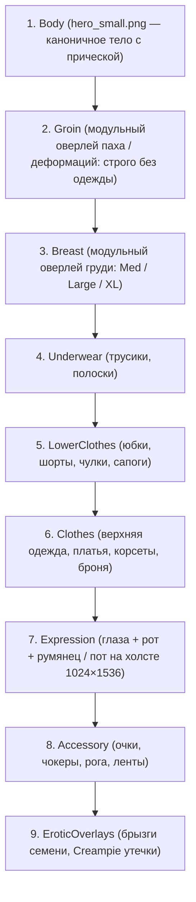

# 🎨 Руководство по созданию спрайтов: «Unbridled Sanctum»
> **Версия:** 2.0 (Каноничный образ Сосуда & Ultra-HD Стандарт)  
> **Целевая аудитория:** Арт-директор, 2D-художник, AI-генератор (Stable Diffusion / ComfyUI / Photoshop / Krita).  
> **Статус документа:** Официальный производственный стандарт для Paper Doll и игровых ассетов.

---

## 1. Главный архитектурный принцип: «Full-Canvas Zero-Offset Overlay»

В нашей игре персонаж и его экипировка собираются из независимых 2D-слоев по технологии **Paper Doll** (бумажная кукла).

### ❗ ЗОЛОТОЕ ПРАВИЛО ХОЛСТА:
> **Все спрайты персонажа (базовое тело, модульная грудь, трусики, одежда, эмоции, румянец, оверлеи семени) ДОЛЖНЫ экспортироваться на едином фиксированном холсте:**
> ### **`1024 × 1536` пикселей (прозрачный 32-bit PNG, RGBA)**

### Почему это критично:
- Спрайт топа, платья, груди или эмоции не обрезается под границы самого элемента, а сохраняет **весь прозрачный холст `1024 × 1536`**, в котором элемент занимает своё естественное анатомическое положение относительно тела.
- В Unity все слои имеют одинаковые параметры:
  - `AnchorMin = (0, 0)`
  - `AnchorMax = (1, 1)`
  - `Pivot = (0.5, 0.5)`
  - `preserveAspect = true`
- **Результат:** Любая одежда, оверлей груди или эмоция надевается на куклу с точностью до пикселя **без необходимости настраивать координаты X, Y и смещения**. Высокое разрешение 1024×1536 обеспечивает кристальную четкость при зуме камеры на Paper Doll.

---

## 2. Каноничный образ героини и иерархия слоев Paper Doll

В игре утвержден **фиксированный каноничный образ героини** (женский Сосуд *Living Crucible*). Редактор выбора причесок и палитры цветов исключен:
- Волосы, черты лица и цвет глаз нарисованы **непосредственно на базовом теле** в высоком авторском качестве.
- Нет необходимости генерировать затылки и чёлки отдельно — они больше не разъезжаются и не требуют шейдеров перекраски.

### Порядок отрисовки слоев (снизу вверх):



| № | Слой (GameObject) | Назначение | Примечания |
|---|---|---|---|
| **1** | `Body` | Базовое тело (`hero_small.png`) | Каноничная фигура Small с волосами, нейтральным лицом и чистой нейтральной анатомией паха |
| **2** | `Groin` | Модульный оверлей деформаций паха | **Видим строго при обнажении.** Автоматически отключается (`enabled = false`) при наличии трусиков или нижней одежды |
| **3** | `Breast` | Модульный оверлей груди (`Medium`, `Large`, `XLarge`) | Для Small выключен (грудь уже на базе). Отключается при закрытой броне |
| **4** | `Underwear` | Нижнее белье (трусики) | Под верхней одеждой. Скрывает слой `Groin` |
| **5** | `LowerClothes` | Юбки, штаны, чулки, обувь | Поверх белья, под рубашкой/топом. Скрывает слой `Groin` |
| **6** | `Clothes` | Верхняя одежда или слитные костюмы | Флаг `hidesBreastLayer` прячет слой №3, слитные костюмы скрывают слой №2 |
| **7** | `Expression` | Лицо: Глаза + рот + румянец | Интегрированная живая эмоция (1024×1536, Zero-Offset, мягкая маска лица) |
| **8** | `Accessory` | Очки, чокеры, ленты, рога | Передний план |
| **9** | `EroticOverlays` | Брызги Cum, капли Creampie | Следы семени на теле и животе |

---

## 3. Модульная система размеров груди (Body Size: 4 ступени)

По канону игры и механикам мутаций плоти (**Flesh Transformation**) у персонажа есть 4 градации объема тела и груди:
- `Small (0)` — базовая стройная фигура с небольшой аккуратной грудью.
- `Medium (1)` — заметная, округлая женственная грудь.
- `Large (2)` — пышная, тяжелая чувственная грудь.
- `XLarge (3)` — сверхпышная, гипертрофированная эротическая грудь.

### Как это устроено технически:
1. **Базовое тело** (`Assets/sprites/doll/hero_small.png`):
   - Одно универсальное тело с размером груди `Small`. Руки, ноги, талия, прическа остаются неизменными.
2. **Модульные оверлеи груди** (`Assets/sprites/doll/`):
   - `Breast_medium.png` (только грудь Medium на прозрачном холсте 1024×1536).
   - `Breast_large.png` (только грудь Large на прозрачном холсте 1024×1536).
   - `Breast_xlarge.png` (только грудь XLarge на прозрачном холсте 1024×1536).
3. **Одежда и правило `hidesBreastLayer`:**
   - **Открытая одежда / украшения / открытое белье** (`hidesBreastLayer = false`):
     - Модульный слой `Breast` остается **включенным** под одеждой.
   - **Закрытая одежда / броня / платья** (`hidesBreastLayer = true`):
     - Модульный слой `Breast` **скрывается**, чтобы ткань не пробивалась кожей.
     - **Для закрытой одежды генерируется комплект из 4 файлов под каждый размер:**
       - `<название>_small.png`
       - `<название>_medium.png`
       - `<название>_large.png`
       - `<название>_xlarge.png`

---

## 4. Модульная система паховой зоны (Groin Deformations & Mutations)

Деформации половой зоны и мутации плоти (набухание, растяжение, эротические изменения) подчиняются строгому правилу экономии ресурсов:

### ❗ ЗОЛОТОЕ ПРАВИЛО ПАХОВОЙ ЗОНЫ:
> **Деформации паха визуализируются СТРОГО на полностью обнаженном теле (без нижнего белья, штанов, юбок и закрытых костюмов).**
> - **В коде:** Слой `Groin` аппаратно выключается (`enabled = false`), как только надет любой закрывающий элемент. Это исключает лишний овердро (overdraw).
> - **Для художника:** Вам **НЕ НУЖНО** рисовать трусики, шорты или платья под деформированный пах! Вся экипировка рисуется в единственном стандартном экземпляре.

### Как рисовать оверлеи деформации паха:
1. **Базовое тело (`hero_small.png`):**
   - Промежность нарисована в чистом, нейтральном, сомкнутом виде без гипердетализации. Это служит нейтральной подложкой.
2. **Оверлеи деформаций (`Assets/sprites/doll/groin/`):**
   - Каждый оверлей создается на том же прозрачном холсте **1024 × 1536 px**.
   - Центральная часть (само влагалище / деформация / мутация) рисуется **100% непрозрачной**, полностью перекрывая базовые линии тела.
   - Края оверлея, заходящие на бедра и низ живота, делаются с **мягкой растушевкой (Feather 6–10 px)** в тон кожи героини, чтобы полностью растворяться на теле без видимых границ.

---

## 5. Пайплайн AI-генерации (ComfyUI / SD Forge / Krita / Photoshop)

### Шаг 1: Базовый манекен (Эталонная база)
Для генерации любой новой экипировки используйте эталонный файл:
📁 `Assets/sprites/doll/hero_small.png` (1024×1536).

> **Совет:** Импортируйте `hero_small.png` в графический редактор или ComfyUI Canvas как заблокированный фоновый слой.

### Шаг 2: Генерация одежды через Inpainting
1. Нарисуйте маску **только на тех участках тела**, где должна появиться одежда.
2. Параметры Inpainting:
   - **Denoising strength:** `0.55` – `0.70`.
   - **Inpaint area:** *Whole picture* (для строгого сохранения анатомии на холсте 1024×1536).
   - **ControlNet:** Подключайте `ControlNet OpenPose` или `ControlNet Lineart/SoftEdge` от базового тела `hero_small.png`, чтобы поза и контуры ни на миллиметр не сдвинулись.

### Шаг 3: Генерация размеров `medium`, `large`, `xlarge`
После утверждения базового варианта `_small`:
1. Замаскируйте область декольте/груди этой одежды.
2. Добавьте в промпт триггеры объема: `(medium breasts:1.1)` $\rightarrow$ `(large breasts:1.2, cleavage)` $\rightarrow$ `(huge breasts:1.3, heavy breasts)`.
3. Сгенерируйте варианты для каждой ступени, следя за тем, чтобы плечи, руки и подол оставались неподвижными.

### Шаг 4: Генерация эмоций лица (`Expression` с интегрированным румянцем)
1. Маскируем на лице область глаз, щёк и рта.
2. Задаем нужную эмоцию в промпте с естественным румянцем: `(heavy blush, flustered, parted lips, heavy breathing, half-closed eyes, tears in eyes:1.2)` для возбуждения или `(angry, furrowed brows, gritted teeth)` для боевого настроя.
3. Экспортируем область лица (глаза + рот + румянец/капли пота) с мягкой растушевкой овала лица на прозрачном холсте 1024×1536. Отдельный слой Blush больше не нужен — румянец естественно и художественно вписан в сам арт лица!

### Шаг 5: Удаление фона и чистка краев (Alpha Matting)
- Фон должен быть **100% прозрачным** (`Alpha = 0`).
- Инструменты: `Rembg (birefnet-anime)` в ComfyUI, плагин `LayerDiffusion`, либо в Photoshop через *Color Range / Select Subject*.
- **Критично:** Применяйте *Defringe (Устранить кайму)* на 1–2 пикселя, чтобы вокруг темной одежды не оставалось белого ореола.

---

## 6. Именование файлов и структура папок

Инструмент в Unity (**`Tools > Sanctum > Paper Doll & Item Factory`**) автоматически распознает файлы и генерирует `ItemData`:

### Структура каталогов:
```text
Assets/
└── sprites/
    ├── doll/                       # Базовое тело, оверлеи груди и паха (1024×1536)
    │   ├── hero_small.png          # Каноничное тело Сосуда (Small)
    │   ├── Breast_medium.png       # Оверлей груди Medium
    │   ├── Breast_large.png        # Оверлей груди Large
    │   ├── Breast_xlarge.png       # Оверлей груди XLarge
    │   └── groin/                  # Оверлеи деформаций паховой зоны (1024×1536)
    │       ├── groin_neutral.png
    │       ├── groin_aroused.png
    │       └── groin_stretched.png
    │
    ├── clothes/                    # Вся экипировка (1024×1536)
    │   ├── <item_id>/
    │   │   ├── <item_id>_small.png
    │   │   ├── <item_id>_medium.png
    │   │   ├── <item_id>_large.png
    │   │   ├── <item_id>_xlarge.png
    │   │   └── <item_id>_icon.png  (Иконка для инвентаря: 256×256 или 512×512)
    │   └── underwear/
    │       ├── underwear_bot.png
    │       ├── underwear_top_small.png
    │       ├── ...
    │
    ├── Expression/                 # Оверлеи эмоций с румянцем (1024×1536)
    │   ├── neutral.png
    │   ├── angry.png
    │   ├── smile.png
    │   ├── shocked.png
    │   ├── flustered.png           # Легкий румянец
    │   ├── lustful.png             # Сильный румянец, истома
    │   └── orgasm.png              # Предельный экстаз, слезы, пот
    │
    └── Accessories Front/          # Очки, чокеры, ленты, рога (1024×1536)
```

---

## 7. Настройки импорта текстур в Unity (Texture Importer)

Когда спрайт помещается в проект, Unity должен настроить его следующим образом:
- **Texture Type:** `Sprite (2D and UI)`
- **Sprite Mode:** `Single`
- **Pixels Per Unit:** `100`
- **Pivot:** `Center (0.5, 0.5)`
- **Generate Mip Maps:** `Выключено (False)`
- **Alpha Source:** `Input Texture Alpha`
- **Alpha Is Transparency:** `Включено (True)`
- **Wrap Mode:** `Clamp`
- **Filter Mode:** `Bilinear`
- **Max Texture Size:** `2048`
- **Compression:** `High Quality / Uncompressed (RGBA32)`

*(В окне `Tools > Sanctum > Paper Doll & Item Factory` эти настройки применяются одной кнопкой ко всей папке автоматически).*

---

## 7. Чек-лист перед добавлением спрайта в игру

- [ ] Разрешение строго **1024 × 1536 px**.
- [ ] Формат **PNG 32-bit (RGBA)** с чистой прозрачностью.
- [ ] Нет белой каймы вокруг темных краев (Defringe 1-2px).
- [ ] Поза и анатомия совпадают с `hero_small.png` (руки, бедра, плечи не сдвинулись).
- [ ] Для закрытой одежды готовы все 4 варианта: `_small`, `_medium`, `_large`, `_xlarge`.
- [ ] Файлы названы по стандарту `<id>_<size>.png` и сложены в свою подпапку.
